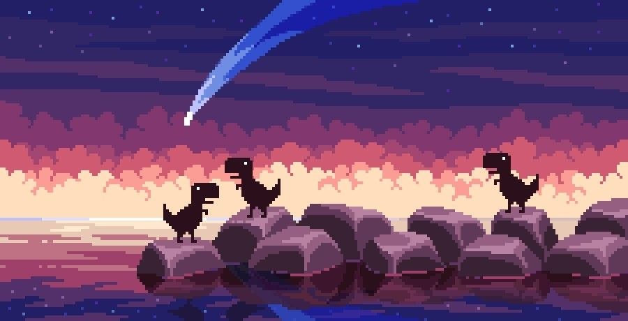

```text

         :::      ::::::::   :::::::: :::::::::::
       :+: :+:   :+:    :+: :+:    :+:    :+:     
     +:+   +:+         +:+ +:+    +:+    +:+      
   +#++:++#++:     +#++:  +#+    +:+    +#+       
  +#+     +#+        +#+ +#+    +#+    +#+        
 #+#     #+# #+#    #+# #+#    #+#    #+#         
###     ###  ########   ########     ###          
```

## About Me

- **Red Team** — web security and vulnerability research
- **DevOps** — deploying and maintaining my own projects
- Main programming language — **Python**
- Currently learning **C++**
- Also interested in 3D printing, digital design, and video

---

## Education

### Additional Education

- Moscow School of Programmers — `2022–2024`
- Self-taught C++ development
- Self-taught Information Security
- letoCTF `2026` — both shifts

---

## CTF Experience

<p align="center">
  
</p>

<p align="center">
  <strong>Chasing flags between the sunset and the stars</strong><br />
  <sub>My main roles in CTF teams</sub><br /><br />
  
  
  
  
</p>

| CTF | Date | Categories |
|:---|:---:|:---|
| **Russian CTF Cup 2025** | `September 2025` | `Web` · `OSINT` · `Steganography` |
| **Alfa CTF 2025** | `September 2025` | `Web` · `OSINT` |
| **Alfa CTF 2026** | `April 2026` | `Web` · `OSINT` · `File` |
| **brunnerctf CTF 2026** | `August 2026` | `Web` · `OSINT` · `File` · `Forensics` · `Steganography` |
| **inno CTF 2026** | `October 2026` | `Steganography` |

<p align="center">
  <sub>✦ Web · OSINT · Forensics · Steganography ✦</sub>
</p>

---

### `Stay curious. Find the trace.`
